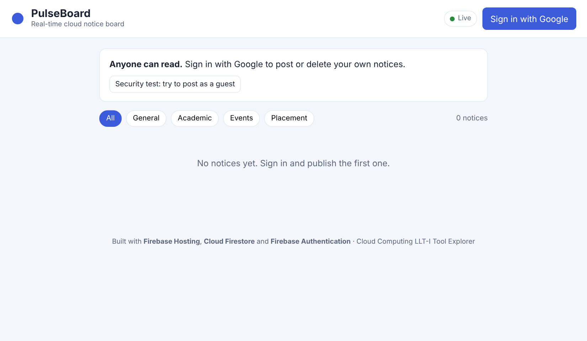
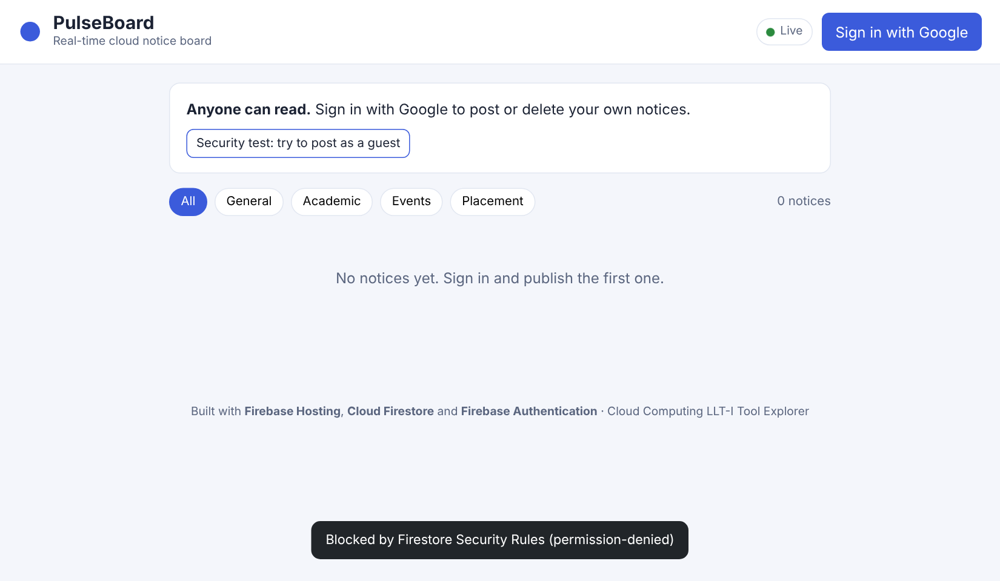
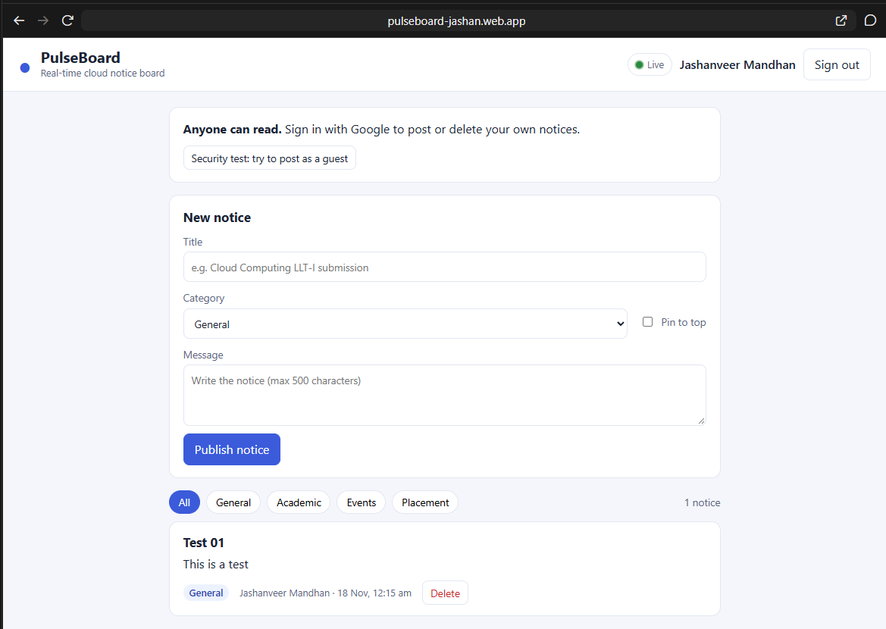
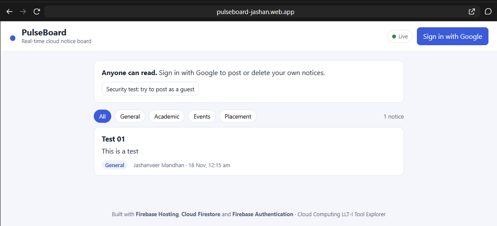

# PulseBoard – A Real-Time Cloud Notice Board using Google Firebase

**Course:** 21CSE362T Cloud Computing · LLT-I Tool Explorer
**Student:** Jashanveer Mandhan (RA2311003010204) · SRM Institute of Science and Technology, Kattankulathur
**Tool explored:** Google Firebase (Hosting + Cloud Firestore + Authentication)
**Live demo:** https://pulseboard-jashan.web.app  |  **Source:** https://github.com/JashanMandhan/pulseboard-firebase

PulseBoard is a small notice-board web app. Anyone can read notices. A user who signs in with Google can publish and delete their own notices. A notice published in one browser appears **instantly** in every other open browser, with no page refresh. The app is used to demonstrate how three Firebase cloud services work together.

## Screenshots (taken from the deployed site)
| Live landing page (Firestore listener connected) | Guest write rejected by Security Rules |
|---|---|
|  |  |

| Signed in with Google: notice published | Signed-out visitor sees the same notice (public read) |
|---|---|
|  |  |

## Firebase services used

| Service | Role in this project | Cloud service model |
|---|---|---|
| **Firebase Hosting** | Serves the static web app (HTML/CSS/JS) over a global CDN with free HTTPS | PaaS |
| **Cloud Firestore** | NoSQL document database; the real-time listener pushes changes to every client | PaaS / DBaaS |
| **Firebase Authentication** | "Sign in with Google" (OAuth 2.0 / OpenID Connect); issues the user identity that Security Rules check | PaaS / identity as a service |

No servers are created, patched or scaled by us. Google manages the infrastructure (IaaS layer) underneath.

## Architecture

```
 Browser (HTML + JS)                         Google Cloud (managed by Firebase)
┌──────────────────────┐   HTTPS (CDN)     ┌─────────────────────┐
│  index.html, app.js  │ ◄──────────────── │  Firebase Hosting   │
│                      │                   └─────────────────────┘
│                      │   Google sign-in  ┌─────────────────────┐
│  Firebase JS SDK     │ ◄───────────────► │  Authentication     │
│                      │                   └─────────┬───────────┘
│                      │   read / write /  ┌─────────▼───────────┐
│                      │   live listener   │  Cloud Firestore    │
│                      │ ◄───────────────► │  + Security Rules   │
└──────────────────────┘                   └─────────────────────┘
```

## Features
- Real-time sync across all open browsers (Firestore `onSnapshot` listener)
- Google sign-in and sign-out
- Publish notices with title, category and message; pin important notices to the top
- Category filter; author-only delete
- Live / Offline connection indicator and an offline cache
- **Security Rules** enforce who can do what at the database (see `firestore.rules`)
- One-click *"Security test"* button that proves a guest write is rejected by the rules

## Project structure
```
pulseboard/
├── public/
│   ├── index.html          # page structure
│   ├── style.css           # styling
│   ├── app.js              # Firebase logic (auth, Firestore, UI)
│   └── firebase-config.js  # your Firebase web-app config (paste here)
├── firestore.rules         # database Security Rules
├── firebase.json           # Hosting + Firestore deploy configuration
└── README.md
```

## Setup and deployment (about 25 minutes)

### 1. Create the Firebase project (browser)
1. Open <https://console.firebase.google.com> and sign in with a Google account.
2. **Create a project** → give it a name → turn Google Analytics **off** → **Create project**.
3. On the project home page click the web icon **`</>`** → register the app (name: `pulseboard-web`) → copy the `firebaseConfig` object shown.
4. **Build → Authentication → Get started → Sign-in method → Google → Enable** → choose a support email → **Save**.
5. **Build → Firestore Database → Create database** → Standard edition → location `asia-south1 (Mumbai)` → **Production mode** → **Create**.

All of this runs on the free **Spark** plan. No payment method is needed. (Do not enable Cloud Storage or Cloud Functions, which require the paid Blaze plan.)

### 2. Configure and deploy (terminal)
```bash
node -v                          # Node.js 20 or newer is required
npm install -g firebase-tools    # install the Firebase CLI
firebase login                   # opens the browser to authorise the CLI
```
Paste your config into `public/firebase-config.js`, then:
```bash
firebase deploy --only hosting,firestore:rules --project YOUR_PROJECT_ID
```
The CLI prints the **Hosting URL**: `https://YOUR_PROJECT_ID.web.app`. Open it, sign in with Google and publish a notice.

### 3. Optional: run locally first
```bash
cd public && python -m http.server 5000     # then open http://localhost:5000
```
`localhost` is an authorised sign-in domain by default.

## Demo script (3 minutes)
1. Open the live URL in two windows side by side (one normal, one private/incognito or on a phone).
2. Window 1: click **Sign in with Google**, publish a notice. Window 2 shows it **instantly** without a refresh.
3. Window 2 (signed out): click **Security test**. The toast reads *Blocked by Firestore Security Rules (permission-denied)*.
4. Delete the notice in Window 1. It disappears from Window 2 as well.
5. Show **Firestore Database → Data** (the `notices` collection) and **Rules** in the console.

## How security works
- The Firebase config in `firebase-config.js` only identifies the project. It is **not a secret**.
- Real protection is in `firestore.rules`: reads are public; a create needs a signed-in user, validated fields (title ≤ 80, message ≤ 500, fixed categories), the user's own `uid`, and the **server timestamp**; notices cannot be edited; only the author can delete; every other path is denied.
- UI text is rendered with `textContent`, so pasted HTML or scripts are shown as plain text and never executed.

## Testing performed
- **Security Rules:** 17 automated tests on the Firebase Local Emulator Suite (guest blocked, spoofed `uid` blocked, oversize/invalid/extra fields blocked, forged timestamp blocked, edits blocked, only the author can delete, other collections denied). All passed.
- **End-to-end browser test:** 16 checks with two independent browser sessions (real-time delivery without reload, pinned ordering, filter, author-only delete, delete propagation, guest write blocked, no script injection). All passed.

## Limits of the free (Spark) plan
Hosting: 10 GB storage and 360 MB/day transfer. Firestore: 1 GiB storage, 50,000 reads/day, 20,000 writes/day. When a limit is reached the service pauses until the next reset; the Spark plan cannot generate a bill.

## Real-world applications of this pattern
Live notice boards, chat and collaboration tools, real-time dashboards, polls and quizzes, order or delivery tracking, and any app that needs *live data + user login + managed hosting* without running its own servers.

## References
- Firebase documentation: <https://firebase.google.com/docs>
- Firebase pricing plans: <https://firebase.google.com/pricing>
- Firestore Security Rules: <https://firebase.google.com/docs/firestore/security/get-started>
